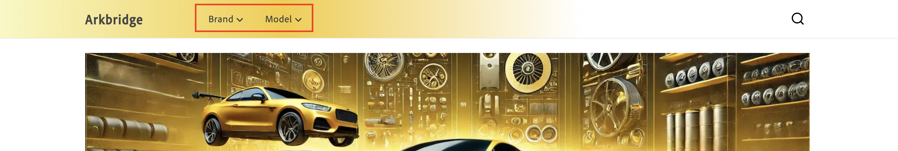

# 정책

정책은 카탈로그 보기의 제품에 적용되는 필터를 정의합니다. 그들은 상점이나 채널로 되돌아오는 제품 구색을 맞춤화하는 데 도움을 줍니다. 이렇게 하면 올바른 콘텐츠가 올바른 대상에 전달됩니다. 예를 들어, 실제 상점, 마켓플레이스 및 Google, Facebook 및 Instagram과 같은 광고 채널이 있습니다.

정책은 브랜드, 모델 또는 부품 범주와 같은 제품 속성을 사용하여 비즈니스 요구 사항에 맞게 카탈로그 데이터를 맞춤화합니다. &#x200B;

## 정책 작업 공간 액세스

*정책* 작업 영역을 여는 방법은 사용하는 제품에 따라 다릅니다.

- **Adobe Commerce 관리자**(Adobe Commerce as a Cloud Service) - *카탈로그* > **정책**&#x200B;을 선택합니다.
- **Adobe Commerce Optimizer Studio** - *스토어 설정* > **정책**&#x200B;을 선택합니다.

## 필터

필터는 정책과 일치하는 제품을 결정하는 속성 기반 조건을 정의합니다. 카탈로그 보기와 연결된 경우 정책은 해당 보기에 대해 반환되는 제품을 사용자 지정하는 데 도움이 됩니다. 제품 속성, 연산자 및 값을 사용하여 일치하는 조건을 정의합니다.

### 필터의 일부

필터는 다음 부품으로 구성됩니다.

| 부분 | 설명 | 예 |
|---|---|---|
| **특성** | 필터링에 사용되는 제품 속성입니다. | `part_category` |
| **연산자** | 속성에 적용되는 조건입니다. | `IN`, `EQUALS`, `CONTAINS` |
| **값 원본** | 값이 `STATIC`인지 `TRIGGER`인지를 지정합니다. | `STATIC` [자세히 알아보기](#value-source-types) |
| **값** | 조건을 충족하는 특정 값. | `brakes, suspension` |

### 예

값이 `brakes` 및 `suspension`인 `IN` 연산자를 사용하는 `part_category`의 필터가 `part_category`이(가) 어느 하나의 값인 제품과 일치합니다.

### 값 소스 유형

값 원본에는 두 가지 유형이 있습니다. **STATIC** 및 **TRIGGER**.

**STATIC**&#x200B;의 **값 원본**&#x200B;이(가) 있는 정책은 유니버설 정책으로 간주됩니다. 보편적 정책은 웹 사이트 전체의 경험을 정의합니다. 즉, 카탈로그 보기는 항상 해당 정책을 실행합니다. 정책 실행은 상점 사용자 상호 작용에 따라 달라지지 않습니다.

**TRIGGER**&#x200B;의 **값 원본**&#x200B;이(가) 있는 정책을 제외 정책이라고 합니다. 즉, 트리거가 API 호출의 헤더에 지정된 경우에만 카탈로그 보기가 해당 정책을 실행합니다. 상점에서는 쇼핑객이 선택한 내용에 따라 정보가 표시됨을 의미합니다. 예를 들어, 다음 이미지에는 두 개의 드롭다운 메뉴가 있습니다. **브랜드** 및 **모델**.



**브랜드** 및 **모델**&#x200B;은(는) 트리거로 정의되어 있습니다.

- `AC-Policy-Brand`
- `AC-Policy-Model`

쇼핑객이 모델 드롭다운을 클릭하면 API 호출의 헤더에 `AC-Policy-Model` 정책과 관련된 제품만 표시하도록 구성된 `AC-Policy-Model`이(가) 포함됩니다.

### 다중 값 HTTP 헤더 트리거 {#multi-value-http-header-triggers}

`HTTP_HEADER` 전송 형식을 사용하는 트리거 정책은 단일 헤더에서 여러 값을 받을 수 있습니다. 값은 쉼표로 구분해야 하며 필터 연산자는 `IN`이어야 합니다. 각 값은 허용되는 일치 항목으로 처리됩니다. 값은 `OR` 의미 체계를 사용하여 평가됩니다.

예를 들어 다음 헤더와 함께 `IN`을(를) 사용하는 정책 필터:

```
AC-Policy-Vehicle: UNIVERSAL,veh-bolt-mammoth-limited-2025
```

`vehicle` 특성이 `UNIVERSAL` 또는 `veh-bolt-mammoth-limited-2025`인 제품과 일치합니다.

반면에 `EQUALS`, `GREATER_THAN_EQUAL` 또는 `LESS_THAN_EQUAL`의 필터 연산자는 유효성 검사 오류로 거부됩니다.

#### 구문 참고 사항

- 헤더 이름은 사용자가 구성하는 트리거 이름과 일치합니다(예: `AC-Policy-Vehicle`).
- 쉼표는 헤더 내에서 개별 값을 구분합니다. 동일한 `AC-Policy-_Name_` 헤더가 두 번 이상 나타나면 해당 값이 쉼표로 구분된 하나의 헤더 값으로 결합됩니다
- 필터 연산자는 `IN`입니다.
- **값 원본**&#x200B;이(가) `TRIGGER`(으)로 설정된 정책 필터.
- **전송 형식**&#x200B;이(가) `HTTP_HEADER`인 트리거입니다.

## 정책 만들기

이 섹션에서는 새 정책을 만듭니다. 정책은 **STATIC** 또는 **TRIGGER**&#x200B;입니다.

### 정적 정책 만들기

1. **[!UICONTROL Policies]** 작업 영역에서 **[!UICONTROL Add Policy]** 단추를 클릭합니다.

   정책 세부 정보를 입력할 수 있는 새 페이지가 열립니다. &#x200B;

1. 정책의 이름을 입력합니다(예: &quot;Celport 부품 범주&quot;).

1. **[!UICONTROL Add Filter]** 단추를 클릭합니다.

   필터 세부 정보를 추가할 수 있는 대화 상자가 열립니다.

1. 필터 세부 사항을 추가합니다. For example:

   1. **특성** - 카탈로그의 특성을 입력합니다. 예: &quot;part_category&quot;. 이 이름은 카탈로그의 속성 이름과 정확히 일치해야 합니다.
   1. **연산자** - 연산자를 선택합니다. 예: **IN**. &#x200B;
   1. **값 Source** - **정적**&#x200B;을 선택합니다. &#x200B;
   1. **값** - 이전에 지정한 특성 정의에서 값을 입력하십시오. 예를 들어, 브레이크 부품에 대한 필터를 생성하려면 &quot;브레이크&quot;를 입력합니다.
   1. 값을 저장하려면 **Enter**&#x200B;를 누르십시오.

      정책이 여러 값을 기준으로 필터링되도록 설계된 경우 각 값을 별도로 입력합니다.

1. 필터 세부 정보 대화 상자에서 **[!UICONTROL Save]** 단추를 클릭합니다. &#x200B;

1. 메뉴 아이콘(...)을 클릭합니다. 만든 필터 옆에 있는 **사용**&#x200B;을 선택합니다. 여기에서 필터를 **편집**, **비활성화** 또는 **삭제**&#x200B;할 수도 있습니다.

   **상태** 열에 녹색 아이콘과 &quot;사용&quot;이라는 단어가 표시됩니다.

1. **[!UICONTROL Save]** 단추를 클릭하여 새 정책을 저장합니다. &#x200B; 단추가 활성화되지 않은 경우 **새 정책** 옆에 있는 연필 아이콘을 클릭하여 정책 이름이 추가되었는지 확인하십시오.

1. 새 정책을 확인하려면 뒤로 화살표를 클릭하여 **[!UICONTROL Policies]** 작업 영역으로 돌아갑니다.

### 트리거 정책 만들기

1. **[!UICONTROL Policies]** 작업 영역에서 **[!UICONTROL Add Policy]** 단추를 클릭합니다.

   정책 세부 정보를 입력할 수 있는 새 페이지가 열립니다. &#x200B;

1. 정책의 이름을 입력합니다(예: &quot;Celport 부품 범주&quot;).

1. **[!UICONTROL Add Trigger]** 단추를 클릭합니다.

   **트리거 세부 정보** 대화 상자가 나타납니다.

1. **AC-Policy-Brand**&#x200B;과(와) 같이 트리거의 이름을 입력하십시오.

1. **전송 형식**&#x200B;을(를) 선택하십시오. **HTTP_HEADER**&#x200B;은(는) 현재 지원되는 유일한 형식입니다.

1. **[!UICONTROL Save]** 단추를 클릭하여 트리거를 저장합니다.

1. **[!UICONTROL Add Filter]** 단추를 클릭합니다.

   필터 세부 정보를 추가할 수 있는 대화 상자가 열립니다.

1. 필터 세부 사항을 추가합니다. For example:

   1. **특성** - 카탈로그의 특성을 입력합니다. 예: &quot;part_category&quot;. 이 이름은 카탈로그의 속성 이름과 정확히 일치해야 합니다.
   1. **연산자** - 연산자를 선택합니다. 예: **IN**. &#x200B;
   1. **값 Source** - **트리거**&#x200B;를 선택합니다. &#x200B;
   1. **값** - 이전에 만든 트리거 이름을 입력하십시오(**AC-Policy-Brand**).

   구성 시 필터는 구성된 트리거를 참조합니다. 런타임 시 API 요청의 헤더는 해당 필터로 평가된 값을 제공합니다.

1. 필터 세부 정보 대화 상자에서 **[!UICONTROL Save]** 단추를 클릭합니다. &#x200B;

1. 메뉴 아이콘(...)을 클릭합니다. 만든 필터 옆에 있는 **사용**&#x200B;을 선택합니다. 여기에서 필터를 **편집**, **비활성화** 또는 **삭제**&#x200B;할 수도 있습니다.

   **상태** 열에 녹색 아이콘과 &quot;사용&quot;이라는 단어가 표시됩니다.

1. **[!UICONTROL Save]** 단추를 클릭하여 새 정책을 저장합니다. &#x200B; 단추가 활성화되지 않은 경우 **새 정책** 옆에 있는 연필 아이콘을 클릭하여 정책 이름이 추가되었는지 확인하십시오.

1. 새 정책을 확인하려면 뒤로 화살표를 클릭하여 **[!UICONTROL Policies]** 작업 영역으로 돌아갑니다.

다음 단계에 따라 제품 가시성을 제어하기 위해 카탈로그 보기에 연결할 수 있는 정책을 만듭니다.
