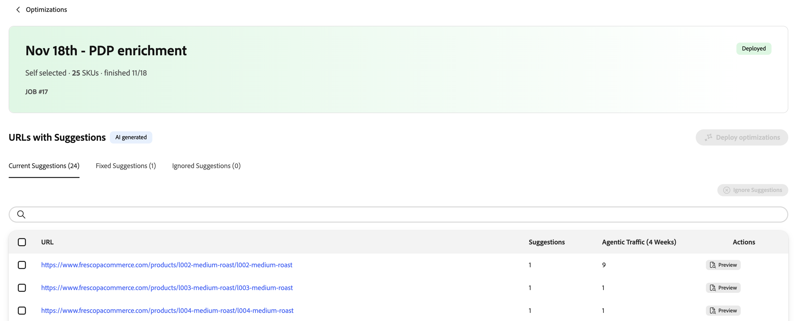

# 제품 세부 사항 페이지 보강

PDP(Product Detail Page) 보강은 사람의 가시 환경을 변경하지 않고 구조화된 제품 데이터를 사용하여 모든 PDP의 LLM에 대한 크롤링 가능성을 극대화합니다. 이 기능은 제품 카탈로그를 통해 LLM에서 쉽게 읽고 구문 분석할 수 있는 각 PDP에 대한 구조화된 데이터 페이로드를 생성합니다.

## 작동 방식 {#how-it-works}

Adobe Commerce 카탈로그에는 속성, 변형, 카테고리, 가격 및 가용성과 같은 제품 정보가 포함되어 있습니다. PDP 보강 작업에서는 AI 에이전트가 사용할 수 있도록 제품 페이지와 카탈로그 팩트 그룹을 선택합니다. 정보는 상점 경험을 변경하지 않고 에이전트를 위해 구성됩니다.

PDP 보강 기능을 사용하여 다음과 같은 작업을 수행할 수 있습니다.

- 라이브 제품 페이지가 있는 특정 활성화된 제품을 선택합니다.
- 작업을 저장하거나 실행하기 전에 선택한 페이지 및 팩트 요약을 검토하십시오.
- 데이터 보강에 포함된 제품 정보를 미리 봅니다.

| 방향 | 목적 |
| --- | --- |
| Commerce 카탈로그 -> 데이터 보강 작업 | 포함할 라이브 제품 페이지 및 카탈로그 팩트를 선택합니다. |
| 데이터 보강 작업 -> AI 에이전트 | 선택한 기존 제품 정보를 구조화된 양식으로 사용할 수 있습니다. 사람이 볼 수 있는 상점들은 변하지 않는다. |

## PDP 보강 액세스

시작하기 전에 배포별 [AI 제품 검색 사전 요구 사항](prerequisites.md)을 검토하십시오. Commerce 플랫폼에 대한 설정을 완료한 후 [관리]에서 **[!UICONTROL AI Product Discovery]**&#x200B;을(를) 열고 **[!UICONTROL Product Details Page Enrichment]**&#x200B;을(를) 선택합니다.

## PDP 강화 2개 경로

PDP 강화 수신에는 두 가지 경로가 있습니다.

- **에이전트 트래픽** - 이 데이터 보강 유형은 Commerce 인스턴스를 구성한 후 24-48시간 후에 자동으로 시작되며 **최적화** 탭에 결과를 표시합니다.
- **데이터 보강 관리자** - 이러한 데이터 보강은 판매자가 **[!UICONTROL Create enrichment]** 단추를 클릭하고 데이터 보강 대상 SKU를 수동으로 선택할 때 구성됩니다. [데이터 보강 관리자](#create-an-enrichment-job)에 대해 자세히 알아보세요.

## PDP 보강 활동 검토

PDP 보강 페이지가 **[!UICONTROL Optimizations]** 탭으로 열립니다. 대시보드를 사용하여 데이터 보강 범위, 작업 활동 및 주의가 필요한 작업을 검토하십시오. **[!UICONTROL Settings]** 탭을 사용하여 Commerce 인스턴스를 AI 제품 검색에 [연결](settings.md)합니다.

### 주의가 필요한 작업 찾기

**[!UICONTROL Needs your attention]** 섹션은 작업이 필요한 작업을 강조 표시합니다. 카드에는 작업 이름, 제품 선택 방법, 제품 페이지 수, 작업 상태 및 진행률이 표시됩니다. 카드에서 사용 가능한 작업을 사용하여 작업을 계속합니다.

### 모든 작업 검색

테이블을 사용하여 작업을 검색하고 추적합니다. **[!UICONTROL Generating]**, **[!UICONTROL Ready to review]**, **[!UICONTROL Deployed]**, **[!UICONTROL Queued]** 또는 **[!UICONTROL Failed]**&#x200B;을(를) 포함하여 작업 세부 정보별로 검색하거나 상태별로 필터링하십시오. 이 표에는 각 작업의 ID, 이름, 원본, 제품 페이지 수, 시작 날짜, 상태 및 사용 가능한 작업이 나열되어 있습니다.

## 데이터 보강 작업 만들기

이 섹션에서는 제품 세부 정보 페이지 데이터 보강 기능을 만드는 방법에 대해 알아봅니다.

1. **[!UICONTROL Optimizations]**&#x200B;에서 **[!UICONTROL Create enrichment]**&#x200B;을(를) 클릭합니다.
1. **데이터 보강 이름**&#x200B;을 입력하십시오(예: &quot;2026년 블랙 프라이데이&quot;).
1. **범주**&#x200B;을 선택합니다(예: &quot;커피&quot;).
1. &quot;보조프로그램&quot;과 같은 **특성 집합**&#x200B;을(를) 선택하십시오.
1. &quot;단순 제품&quot;과 같은 **제품 유형**&#x200B;을(를) 선택하십시오.
1. **가격 범위**&#x200B;를 선택하십시오.
1. **[!UICONTROL Apply filters]**&#x200B;을(를) 클릭합니다.

   데이터 보강 기준과 일치하는 제품을 미리 보고 **사용자 지정**&#x200B;을 클릭하여 데이터 보강 기준에 맞는 제품의 범위를 추가로 지정할 수 있습니다.

1. 보강할 특정 제품을 확인하려면 **[!DNL Next]**&#x200B;을(를) 클릭하십시오.
1. **[!DNL Run enrichment]**&#x200B;을(를) 클릭합니다.

   데이터 보강 작업이 실행되고 **최적화** 테이블에 표시됩니다. 실행이 완료되면 최적화를 [검토 및 배포](#review-and-deploy-an-enrichment-job)할 수 있습니다.

### 데이터 보강 작업 검토 {#review-and-deploy-an-enrichment-job}

데이터 보강 작업을 엽니다.

**제안이 있는 URL** 표에는 데이터 보강 기회가 있는 모든 제품이 나열되어 있습니다. 각 제품에 대해 다음을 수행할 수 있습니다.

- AI 분석 및 제안된 데이터 보강 기능을 보려면 **행을 확장**&#x200B;하십시오.
- 브랜드 음성 및 머천다이징 지침에 맞추기 위해 적용하기 전에 제안된 제품 이름 또는 설명을 **편집**&#x200B;하십시오.
- 보강할 제품에 대해 **최적화를 배포**&#x200B;하고 Adobe Commerce 상점 앞에 직접 게시합니다.
- 데이터 보강이 검토 및 적용되면 **고정으로 표시**.
- 카탈로그 전략과 관련이 없는 제안을 **무시**&#x200B;합니다.

제안은 다음 세 가지 보기로 구성됩니다. **현재 제안**, **수정 제안** 및 **무시된 제안**. 데이터 보강이 적용되면 상태가 **적용됨**&#x200B;인 **수정 제안**(으)로 이동합니다. 적용된 풍부함은 언제든지 롤백할 수 있습니다.

### 최적화 배포

제안을 검토하고 최적화할 제품 페이지를 선택했으면 **최적화 배포**&#x200B;를 클릭하여 Edge에서 최적화를 사용하여 데이터 보강 기능을 게시합니다. **Edge에 배포** 확인 대화 상자에 선택한 제품 URL, 최적화 유형 및 적용 중인 데이터 보강이 표시됩니다. 배포 후 성공적으로 최적화된 제품 페이지를 확인하는 화면이 표시됩니다.

최적화는 [Edge에서 최적화](https://experienceleague.adobe.com/en/docs/brand-visibility/using/resources/optimize-at-edge/fastly-byocdn)를 통해 AI 사용자 에이전트에게만 제공됩니다. 사람 방문자는 PDP 디자인, 페이지 성능 또는 브랜드 경험을 변경하지 않고 이전과 동일하게 기존 상점 경험을 계속 볼 수 있습니다.

## 제한 및 고려 사항 {#limits}

- 라이브 제품 페이지가 있는 활성화된 제품만 선택할 수 있습니다.
- 데이터 보강은 카탈로그에 이미 있는 팩트를 구성합니다. 새 제품 정보를 추가하지는 않습니다.
- PDP 보강 워크플로우가 상점 전면을 변경하지 않습니다.
- PDP 보강 작업과 카탈로그 보강 작업에는 서로 다른 목적과 워크플로가 있습니다.
- PDP 최적화는 [Edge에서 최적화](https://experienceleague.adobe.com/en/docs/brand-visibility/using/resources/optimize-at-edge/fastly-byocdn)를 사용합니다.

## 우수 사례 {#best-practices}

- 제품 그룹 또는 캠페인을 식별하는 명확한 작업 이름을 사용합니다.
- 작업에 포함된 팩트를 미리 보고 AI 에이전트에 대해 정확하고 적절한지 확인합니다.
- 건너뛰거나 덮어쓰기로 결정하기 전에 제품이 이미 보강되었는지 확인합니다.
- 이러한 기록을 담당하는 팀과 카탈로그 동기화 및 제품 팩트의 소유권을 조정합니다.

## 예: 변형 및 사양으로 제품 강화

제품 페이지에는 종종 AI 에이전트가 읽을 수 있는 것보다 더 많은 카탈로그 정보가 들어 있습니다. 예를 들어, 한 상인이 방수 기능이 있는 하이킹 부츠를 판매한다. 크기, 너비 및 색상 옵션은 JavaScript과 함께 로드되는 변형 선택기에 있습니다. 재료, 방수 및 관리 지침이 축소된 세부 정보 탭에 있고 맞춤 지침이 팝업으로 열립니다. 쇼핑객은 이 모든 것을 열 수 있지만 페이지가 처음 로드될 때 읽는 AI 웹 크롤러는 제품 이름, 가격 및 간단한 설명만 볼 수 있습니다.

이 제품에서 데이터 보강 작업이 실행되면 속성 및 모든 변형을 포함한 제품의 카탈로그 데이터를 모두 가져와서 AI 에이전트가 읽을 수 있는 구조화된 형식으로 패키징합니다. 그런 다음 AI 비서가 &quot;이 부츠가 사이즈 11에 맞는 와이드 핏으로 제공됩니까?&quot;와 같은 질문에 답할 수 있습니다. 아니면 &quot;완전 방수가 되나요?&quot; 판매자의 카탈로그 데이터에서 가져온 것입니다.

데이터 보강 작업은 카탈로그에 이미 있는 정보만 사용합니다. 새 제품 팩트를 만들지 않으며 쇼핑객이 보는 제품 페이지도 변경되지 않습니다.
