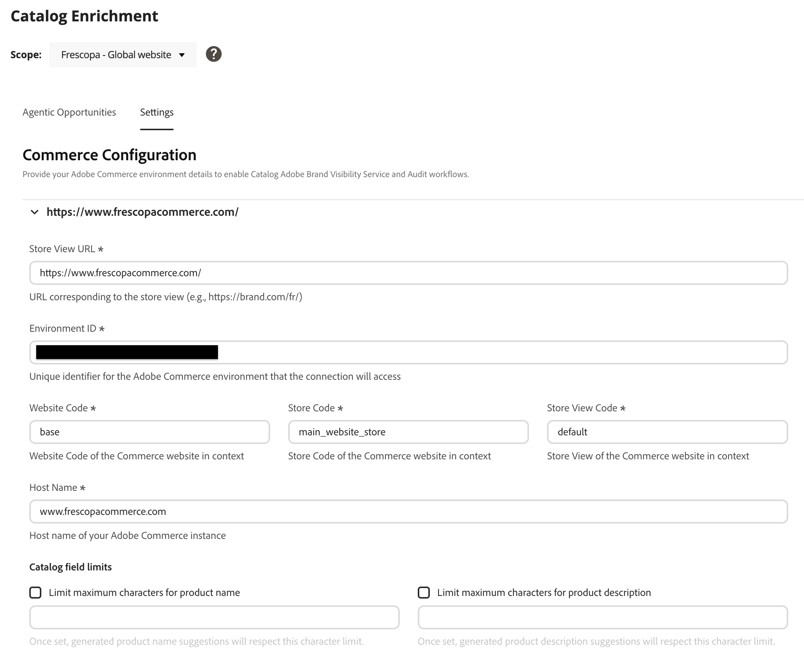

# 데이터 보강 설정

AI 제품 검색 작업 영역의 **[!UICONTROL Settings]** 탭을 사용하여 Adobe Commerce 인스턴스를 구성합니다. 구성이 완료되면 카탈로그 및 PDP 보강이 AI 제품 검색 작업 영역에 표시됩니다.

이 탭의 필드는 AI 제품 검색이 연결되는 [!DNL Adobe Commerce] 환경 및 스토어 보기를 식별합니다. IMS 로그인 및 조직 요구 사항에 대해서는 [AI 제품 검색 사전 요구 사항](prerequisites.md)을 참조하십시오.

1. 관리자의 **[!UICONTROL AI Product Discovery]** > **[!UICONTROL Catalog Enrichment]** 또는 **[!UICONTROL Product Details Page Enrichment]**(으)로 이동합니다.
1. 페이지 상단의 **[!UICONTROL Scope]** 목록에서 구성할 저장소 보기를 선택하거나 **[!UICONTROL All Store Views]**&#x200B;을(를) 떠나 저장소 보기 간 설정을 관리합니다.
1. **[!UICONTROL Settings]** 탭을 엽니다.
1. **[!UICONTROL Commerce Configuration]**&#x200B;에서 해당 URL로 레이블이 지정된 저장소 보기 패널을 확장합니다.

   AI 제품 검색 서비스 및 감사 워크플로를 사용하도록 설정하려면 [!DNL Adobe Commerce] 환경 세부 정보를 제공하십시오.

   카탈로그 데이터 보강 설정 탭의 {zoomable="yes"}

1. 저장소 보기에 필요한 연결 세부 정보를 입력합니다.

   - **[!UICONTROL Store View URL]**: 스토어 보기에 해당하는 URL(예: `https://brand.example.com/fr/`).
   - **[!UICONTROL Environment ID]**: 연결에 액세스하는 [!DNL Adobe Commerce] 환경에 대한 고유 식별자입니다.
   - **[!UICONTROL Website Code]**, **[!UICONTROL Store Code]** 및 **[!UICONTROL Store View Code]**: Commerce 웹 사이트의 웹 사이트, 스토어 및 스토어 보기 코드. 이러한 값은 Commerce 관리자의 코드와 일치해야 합니다.
   - **[!UICONTROL Host Name]**: [!DNL Adobe Commerce] 인스턴스의 호스트 이름입니다.
   - **(선택 사항 - 카탈로그 보강만 해당)** **[!UICONTROL Catalog field limits]**&#x200B;에서 **[!UICONTROL Limit maximum characters for product name]**&#x200B;을(를) 선택하고 생성된 제품 이름에 대한 문자 제한을 지정하십시오. **[!UICONTROL Limit maximum characters for product description]**&#x200B;을(를) 선택하고 생성된 제품 설명에 대한 문자 제한을 지정합니다.

1. **[!UICONTROL Save]**&#x200B;을(를) 클릭합니다.

저장한 후 해당 저장소 보기에 대한 카탈로그 또는 감사 결과에 의존하기 전에 초기 동기화 또는 유효성 검사 작업이 완료될 때까지 기다리십시오. 제품 제안이 **[!UICONTROL Catalog Enrichment]** 페이지에 표시되는 데 최대 24시간이 걸릴 수 있습니다.

저장소 보기 구성을 제거하려면 해당 항목을 확장하고 **[!UICONTROL Delete]**&#x200B;을(를) 클릭합니다.

## 필드 설명 {#commerce-connection-fields}

필수 필드는 **[!UICONTROL Commerce Configuration]** 양식에 별표(*)로 표시됩니다.

| 필드 | 필수 | 설명 |
| --- | --- | --- |
| 보기 URL 저장 | 예 | 스토어 보기에 해당하는 URL(예: `https://brand.example.com/fr/`). |
| 환경 ID | 예 | 연결에 액세스하는 [!DNL Adobe Commerce] 환경에 대한 고유 식별자입니다. |
| 웹 사이트 코드 | 예 | Commerce 웹 사이트의 웹 사이트 코드. |
| 코드 저장 | 예 | Commerce 웹 사이트의 스토어 코드. |
| 보기 코드 저장 | 예 | Commerce 웹 사이트의 스토어 보기. |
| 호스트 이름 | 예 | [!DNL Adobe Commerce] 인스턴스의 호스트 이름입니다. |
| 카탈로그 필드 제한(카탈로그 보강만 해당) | 아니요 | 생성된 제품 이름 및 설명에 대한 문자 제한을 정의합니다. |
