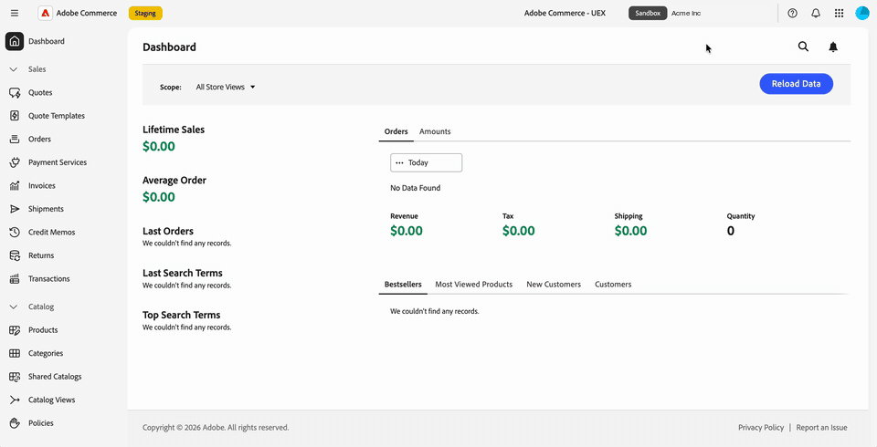
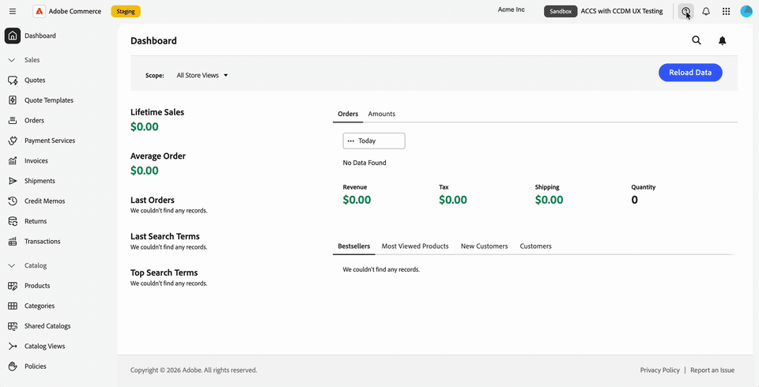

# Adobe 통합 경험의 Commerce 관리

Commerce Cloud Manager에서 인스턴스 이름을 선택하면 Adobe Commerce as a Cloud Service용 Commerce Admin Console이 Adobe 통합 경험에 열립니다.

Adobe 통합 경험 인터페이스는 Adobe 제품에서 사용되는 공유된 상단 탐색, 업데이트된 왼쪽 탐색 및 새로 고친 관리자 페이지 스타일을 제공합니다.

조직, 제품 및 Commerce 인스턴스 간에 전환하고 상단 탐색에서 도움말, 알림 및 계정 환경 설정에 액세스할 수 있습니다. 기존 Commerce 역할 권한은 계속해서 액세스할 수 있는 관리 메뉴 항목을 결정합니다.

>[!NOTE]
>
>Adobe 통합 경험의 Commerce 관리자는 Adobe Commerce as a Cloud Service에만 사용할 수 있습니다. Adobe Commerce on cloud infrastructure 및 Adobe Commerce 온-프레미스 고객은 [클래식 Commerce 관리 UI](admin.md)를 계속 사용합니다.

{width="800" zoomable="yes" border="light"}

## Commerce 관리자 열기

[Adobe Experience Cloud](https://experience.adobe.com/){target="_blank"}에 로그인한 후 Commerce Cloud Manager를 엽니다. 그런 다음 인스턴스를 선택하여 통합 경험에서 관리자를 엽니다.

로그인 흐름을 사용하면 각 인스턴스에 개별적으로 로그인하지 않고도 Commerce 인스턴스 간에 이동할 수 있습니다.
추가 로그인 프롬프트 없이 Adobe 제품과 Commerce 인스턴스 간에 이동할 수 있습니다.

액세스 프로시저는 _Adobe Commerce as a Cloud Service 안내서_&#x200B;에서 [인스턴스 액세스](https://experienceleague.adobe.com/en/docs/commerce/cloud-service/getting-started#access-an-instance){target="_blank"}를 참조하십시오.

>[!BEGINTABS]

>[!TAB Commerce Cloud 관리자에서 관리자 열기]

{width="800" zoomable="yes" border="light"}

>[!TAB 작동 중 보기]

{width="800" zoomable="yes" border="light"}

>[!ENDTABS]

### 관리 인터페이스 선택 {#classic-ui}

통합 경험에서 Commerce 관리자의 초기 릴리스의 경우, Adobe Commerce as a Cloud Service은 Adobe 통합 경험과 클래식 UI라는 두 가지 Commerce 관리 경험을 지원합니다.

기본적으로 Commerce Cloud Manager에서 Commerce 인스턴스를 선택하면 Commerce 관리자가 Adobe 통합 경험에서 열립니다. 클래식 UI로 다시 전환하려면 기존 책갈피를 사용하거나 클래식 UI에 대한 URL을 찾습니다. [클래식 UI 열기](#open-classic-ui)를 참조하십시오.

통합 경험 및 클래식 UI에 대한 링크는 Commerce Cloud Manager의 인스턴스 세부 사항 패널에서 사용할 수 있습니다.

| 링크 | 경험 |
| --- | --- |
| **[!UICONTROL Admin URL (Unified Shell UI)]** | 통합 경험에서 관리자 열기 |
| **[!UICONTROL Admin URL (Classic UI)]** | 이전 관리자 인터페이스를 엽니다. |

{width="800" zoomable="yes" border="light"}

_인스턴스 목록 스크린샷과 업데이트된 인스턴스 세부 사항 디자인을 기반으로 하는 일러스트레이션입니다. 표시된 URL은 스테이징 호스트를 사용합니다._

#### URL 형식

| 경험 | URL 패턴 |
| --- | --- |
| 통합 경험 | `https://<experience-cloud-host>/#/@<organization>/in:<instance-id>/commerce/cloud-service/admin` |
| 클래식 UI | `https://<commerce-admin-host>/<instance-id>/admin/` |

통합 경험은 `@` 이후에 조직을 식별하고 `in:` 이후에 인스턴스를 식별합니다. 클래식 UI는 호스트 이름 바로 뒤에 인스턴스 ID를 배치합니다.

예를 들어 이러한 스테이징 URL은 동일한 인스턴스를 엽니다.

- **통합 경험**: `https://experience-stage.adobe.com/#/@adobe-commerce-uex/in:<instance-id>/commerce/cloud-service/admin`
- **클래식 UI**: `https://na1-stage.admin.commerce.adobe.com/<instance-id>/admin/`

이러한 스테이징 호스트 이름은 프로덕션 URL이 아닙니다. URL을 구성하는 대신 항상 Commerce Cloud Manager의 인스턴스 링크를 사용하십시오.

#### 클래식 UI 열기

클래식 UI를 열려면 다음을 수행하십시오.

- 기존 클래식 관리 책갈피 또는 URL을 사용합니다. 이러한 URL은 클래식 UI만 열고 통합 경험으로 리디렉션되지 않습니다.
- Commerce Cloud Manager 인스턴스 세부 정보에서 **[!UICONTROL Admin URL (Classic UI)]**&#x200B;을(를) 선택합니다.

관리자 내부에 인터페이스 스위치가 없습니다. 필요한 경우 Commerce Cloud Manager 또는 저장된 관리자 URL을 사용하여 클래식 인터페이스로 돌아갑니다.

## 조직 및 인스턴스 식별

변경하기 전에 작업 중인 조직과 인스턴스를 확인합니다.

- 계정 메뉴에 현재 조직이 표시됩니다.
- 위쪽 탐색의 인스턴스 전환기에는 인스턴스 이름과 **[!UICONTROL Production]** 또는 **[!UICONTROL Sandbox]** 배지가 표시됩니다.

환경 배지를 사용하여 인스턴스 간에 전환할 때 프로덕션 인스턴스와 샌드박스를 구별합니다.

## 조직, 제품 및 인스턴스 전환

위쪽 탐색에는 작업 컨텍스트를 전환하기 위한 별도의 컨트롤이 있습니다.

### 조직 전환

맨 위 탐색에 있는 조직 전환기를 사용하여 액세스 권한이 있는 조직 간에 이동합니다.

1. 위쪽 탐색에서 조직 이름을 선택합니다.

1. 목록에서 조직을 선택합니다.

   액세스 권한이 있는 조직이 목록에 표시됩니다. 확인 표시는 작업 중인 조직을 식별합니다.

>[!BEGINTABS]

>[!TAB 조직 전환기]

{width="800" zoomable="yes" border="light"}

>[!TAB 작동 중 보기]

{width="800" zoomable="yes" border="light"}

>[!ENDTABS]

계정 메뉴에는 작업 중인 조직도 표시됩니다. 위쪽 탐색에서 프로필 사진({width="24"})을 선택한 다음 **[!UICONTROL Organization]** 줄을 확인하세요.

{width="800" zoomable="yes" border="light"}

열 수 있는 인스턴스는 작업 중인 조직에 속합니다. 인스턴스를 변경하려면 [Commerce 인스턴스 전환](#switch-commerce-instances)을 참조하세요.

### 제품 전환

언제든지 응용 프로그램을 변경하려면 위쪽 탐색의 제품 전환기({width="24"})를 사용하십시오. 다른 Adobe 제품에서와 동일한 방식으로 작동합니다.

- **Admin Console**: 제품 전환기에서 Adobe Admin Console을 열어 사용자와 사용자의 액세스를 관리합니다(**[!UICONTROL Administer]** > **[!UICONTROL Users]**). URL은 기억할 필요가 없습니다. Adobe Admin Console은 스토어를 관리하는 Commerce 관리자와 별개입니다.
- **Adobe Exchange**: Adobe Creative Cloud, Adobe Experience Cloud 및 Adobe Document Cloud에서 타사 확장, 플러그인, 스크립트 및 엔터프라이즈 통합을 찾아보십시오.
- **기타 제품**: Coworker와 같은 제품을 엽니다.

>[!BEGINTABS]

>[!TAB 제품 전환기 메뉴]

{width="800" zoomable="yes" border="light"}

>[!TAB 작동 중 보기]

{width="800" zoomable="yes" border="light"}

>[!ENDTABS]

Adobe Commerce as a Cloud Service 사용자 및 역할 관리에 대해서는 [사용자 관리](https://experienceleague.adobe.com/en/docs/commerce/cloud-service/user-management){target="_blank"}를 참조하십시오.

### Commerce 인스턴스 전환

상단 탐색에는 인스턴스 전환기 버튼이 포함되어 있습니다. 항상 **[!UICONTROL Production]** 또는 **[!UICONTROL Sandbox]** 배지와 현재 있는 인스턴스의 이름을 표시합니다.

1. 상단 탐색에서 현재 인스턴스 이름 및 환경 배지를 표시하는 인스턴스 전환기를 선택합니다.

1. 목록에서 인스턴스를 선택합니다.

   이 목록에는 현재 조직에서 액세스할 수 있는 Adobe Commerce as a Cloud Service 인스턴스가 포함되어 있습니다. 인스턴스를 전환하기 위해 Commerce Cloud Manager로 돌아갈 필요가 없으므로 인스턴스 간에 앞뒤로 이동할 수 있습니다.

1. 작업을 계속하기 전에 인스턴스 이름 및 환경 배지를 확인하십시오.

인스턴스는 페이지 URL의 일부이므로 책갈피에 추가하거나 특정 인스턴스를 여는 링크를 공유할 수 있습니다. 링크에서 인스턴스 없이 관리자를 열면 사용한 마지막 인스턴스가 로드됩니다.

## 왼쪽 탐색 사용

Commerce 통합 경험의 왼쪽 탐색 창에 Adobe 관리 메뉴가 나타납니다. 메뉴 섹션을 확장하거나 축소하여 필요한 도구를 찾거나 입력하여 메뉴 항목으로 이동합니다.

메뉴는 작업 중인 인스턴스별로 다릅니다. 인스턴스를 전환하면 왼쪽 탐색이 일치하도록 업데이트됩니다.

기존 역할 권한이 이월됩니다. 역할이 허용하는 메뉴 항목만 표시됩니다.

제품, 주문, 고객 및 구성 관리와 같은 작업에 대해서는 관리 안내서를 계속 사용하십시오. 관리 페이지는 스타일이 새로 고쳐졌으므로 이 안내서의 클래식 UI 스크린샷과 모양이 다를 수 있습니다.

>[!BEGINTABS]

>[!TAB Commerce 관리자 왼쪽 탐색]

{width="800" zoomable="yes" border="light"}

>[!TAB 작동 중 보기]

{width="800" zoomable="yes" border="light"}

>[!ENDTABS]

## 도움말 및 피드백 제공

Commerce 관리자를 종료하지 않고 리소스에 액세스하려면 상단 탐색의 도움말 아이콘({width="24"})을 사용하여 도움말 패널을 여십시오.

- **도움말**: 패널에서 직접 Adobe Experience League에서 설명서를 검색합니다.
- **지원**: 커뮤니티 포럼 및 기타 학습 리소스에 액세스하고 Adobe Experience League에서 지원 티켓을 찾으십시오.
- **피드백**: 같은 패널에서 Adobe에 피드백을 제출합니다.

도움말, 지원 및 피드백은 컨텍스트에서 사용할 수 있습니다. Commerce 관리 위치에 계속 머무르며 위치를 잃지 마십시오.

>[!BEGINTABS]

>[!TAB 도움말 패널]

{width="800" zoomable="yes" border="light"}

>[!TAB 작동 중 보기]

{width="800" zoomable="yes" border="light"}

>[!ENDTABS]

## 알림 보기 {#view-notifications}

컨텍스트에서 알림, 요청 및 제품 공지를 보려면 위쪽 탐색에서 벨 아이콘({width="24"})을 사용하여 알림 패널을 엽니다.

패널은 **[!UICONTROL Requests]**, **[!UICONTROL Notifications]** 및 **[!UICONTROL Announcements]**&#x200B;을(를) 한 곳에 모읍니다. Commerce 관리자를 종료하여 이러한 항목을 볼 필요가 없습니다.

Commerce 페이지 헤더 내의 알림 컨트롤 대신 이 패널의 통합 경험 상단 탐색에 있는 벨 아이콘을 사용합니다. Commerce 관리자 받은 편지함 메시지에 대한 지침은 [메시지 받은 편지함](admin-message-inbox.md)을 참조하세요.

>[!BEGINTABS]

>[!TAB 알림 패널]

{width="800" zoomable="yes" border="light"}

>[!TAB 작동 중 보기]

{width="800" zoomable="yes" border="light"}

>[!ENDTABS]

## 계정 환경 설정 관리

위쪽 탐색에서 프로필 사진({width="24"})을 선택하여 계정 메뉴를 엽니다. 이 메뉴에서 다음 작업을 수행할 수 있습니다.

- 작업 중인 조직을 봅니다.
- **[!UICONTROL Dark theme]** 토글을 사용하여 어두운 모드를 켜십시오.
- 사용자 환경 설정을 엽니다.

>[!BEGINTABS]

>[!TAB 어두운 모드의 계정 메뉴]

{width="800" zoomable="yes" border="light"}

>[!TAB 작동 중 보기]

{width="800" zoomable="yes" border="light"}

>[!ENDTABS]

## 업데이트된 페이지 스타일

Commerce 관리자의 페이지는 Adobe Unified Experience와 일치하는 새로운 모양입니다. 이후 릴리스에 대해 더 많은 스타일 변경이 계획되어 있습니다.

>[!MORELIKETHIS]
>
>[Adobe CX Enterprise 인터페이스 및 관리 안내서](https://experienceleague.adobe.com/en/docs/core-services/interface/experience-cloud)
